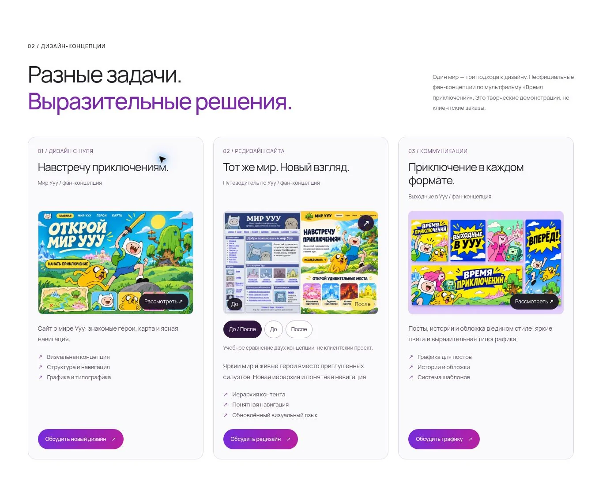

# Компактные концепции Design

Три концепции собраны в один ряд карточек на широком экране. Уменьшены изображения, заголовки и отступы, сокращены повторяющиеся описания. Основной текст остаётся 14 px. На планшете — горизонтальные карточки, на телефоне — вертикальные.

Высота секции в проверенном окне: 1134 px вместо 3876 px. Иллюстрации и подписи сохранены, для редизайна добавлен крупный просмотр пары до/после. Переключение отдельных вариантов также работает.

Проверка: 11 тестов, синтаксис, статическая сборка; просмотр сравнения/Escape; мобильные ширины 320, 375 и 768 px без горизонтального переполнения.

Ветка `feat/design-compact-cards`. До согласования эта версия не публикуется.
