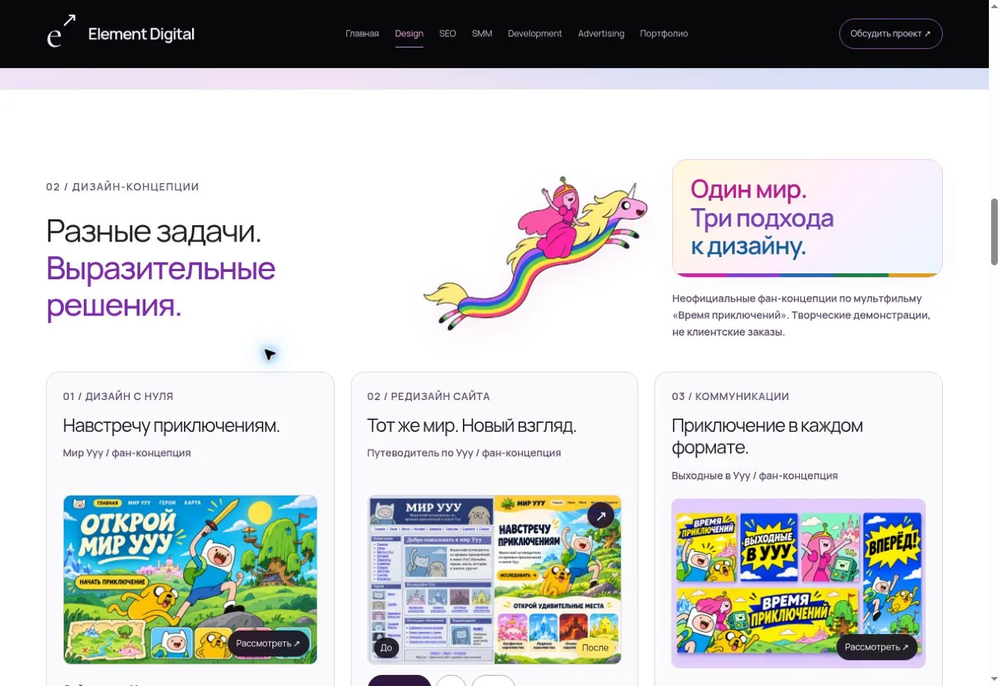

# Design: иллюстрация, вопросы и подвал

В блок концепций добавлена летящая Леди Ливнерог с Принцессой Бубльгум. Иллюстрация имеет прозрачный фон и мягкое движение, которое отключается при уменьшенном движении. Компактная галерея сохранена.

Раздел «Обсудим важное» содержит семь подробных ответов простым разговорным языком: результат, подготовка задания, цена и сроки, поиск стиля, правки, редизайн и передача материалов. Первый ответ сразу раскрыт, остальные доступны по нажатию. Условия работ и стоимость не выдумывались.

Подвал Design занимает всю ширину и продолжает тёмный фон формы. Убраны светлые боковые полосы, восстановлен размер бренда, отступы и переносы ссылок на телефоне.

Проверено: 11 тестов, синтаксис, обе сборки. В браузере — иллюстрация, раскрытие FAQ, мобильная читаемость и подвал. На ширинах 320, 375 и 1903 px нет горизонтального переполнения; подвал начинается в x=0 и равен ширине страницы.

[Вопросы](review-images/design-faq-review.webp) · [Подвал](review-images/design-footer-review.webp)

Ветка `feat/design-faq-rainicorn`, до согласования без публикации.
