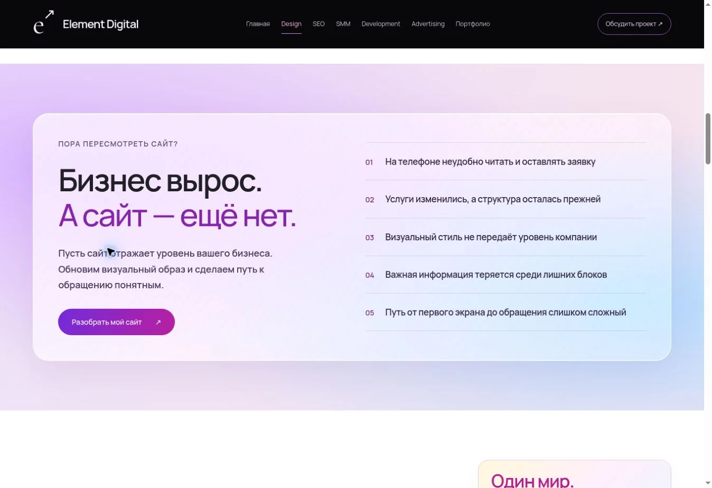

# Design: стекло, цвет и управление жвачкой

Блок «Бизнес вырос» оформлен как стеклянная панель: полупрозрачная заливка, светлая кромка, размытие и цветная подсветка. Заголовок и описание увеличены, текст переписан вокруг обновления образа бизнеса и понятного пути к обращению.

«Один мир — три подхода к дизайну» получил крупный цветной акцент с розовым, фиолетовым, синим, зелёным и жёлтым мотивом референса. Компактная сетка концепций сохранена.

Мелкие подписи и текст сделаны крупнее, полужирными и контрастнее. Основной текст 14–18 px в зависимости от роли.

Розовая кнопка теперь надувает пузырь, фиолетовая — лопает. Поддержаны повторные действия, защита от гонок быстрых нажатий и уменьшенное движение.

Проверено: 11 тестов, синтаксис, Worker и статическая сборки; в браузере фиолетовый → popped, розовый → inflating → idle, финальная подпись «Пузырь надут». На телефоне выполнен тот же цикл. На ширинах 320, 375 и 768 px нет горизонтального переполнения.

[Радужный акцент](review-images/design-rainbow.webp) · [Телефон](review-images/design-glass-mobile.webp)

Ветка `feat/design-glass-rainbow`, до согласования без публикации.
