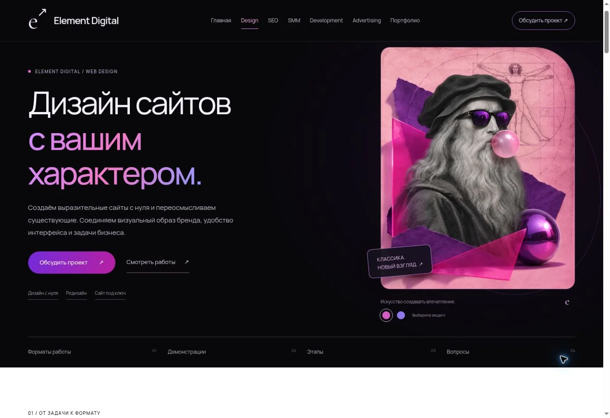

# Design: страница для согласования

Ветка: `feat/design-neon-web`. Основа — опубликованная версия main `83e3fd6`.

## Что изменено

Страница `/design/` переработана по визуальному направлению https://veonix.ru/website/web-design/: тёмное начало, крупные градиентные заголовки, скруглённые кнопки и светлые блоки с составом услуг. Сохранены Element Digital, логотип e↗, выбранный коллаж Леонардо, очки, розовая жвачка и витрувианский человек.

Добавлены три формата работы, признаки необходимости редизайна, демонстрации, принципы, этапы, оценка задачи, результаты и FAQ. У демонстраций сохранены честные подписи и работающие URL. Цены, клиентские результаты и отзывы не выдумывались.

В форме Design можно выбрать формат проекта. Кнопки услуг выбирают соответствующий вариант; выбранное значение добавляется в текст обращения. Остальные страницы сохраняют прежнюю форму.

## Проверка

Синтаксис, 11 автоматических тестов и обе сборки. Проверяются все 12 маршрутов, метаданные, локальные ссылки, якоря и серверная безопасность формы.

В браузере: первый экран и проекты, переходы к разделам, оба цветовых акцента, FAQ, мобильное меню и закрытие Escape. На ширинах 320, 375 и 768 px горизонтального переполнения нет. Проверена подготовка обращения с форматом «Редизайн сайта».

На статическом хостинге обращение подготавливается для ручной отправки в Telegram. Автоматическая доставка по-прежнему требует настройки backend. Внешние сообщения при проверке не отправлялись.

## Просмотр

[Страница целиком](review-images/design-v3-full.webp)

[Мобильные экраны](review-images/design-v3-mobile.webp)

[Планшет](review-images/design-v3-tablet.webp)

## Публикация

Эта версия не слита в main и не опубликована на GitHub Pages. Сначала требуется согласование обновлённого вида.
