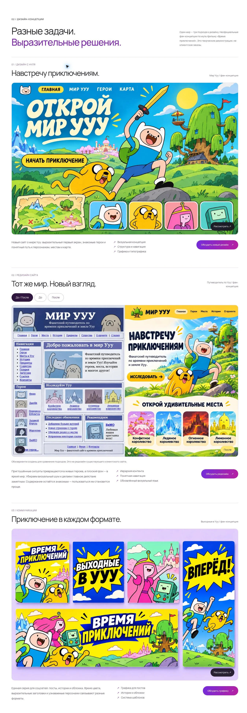

# Design: концепции и взаимодействие

Ветка `feat/design-showcase-bubble`, основа — опубликованная версия `9ac57f2`.

## Изменения

Леонардо и выбранная графика сохранены. При нажатии на цветовой акцент жвачка раздувается, лопается и исчезает. Повторное нажатие запускает эффект снова. При уменьшенном движении показывается конечное состояние без анимации. Экранный диктор получает сообщение о хлопке.

Мелкие подписи увеличены до 12–14 px, основной текст — до 14–16 px; увеличены кнопки выбора акцента и подписи формы. Заголовки сохраняют прежнюю иерархию.

Вместо повторения «Берег / Форма / Поток» на Design созданы три отдельные неофициальные фан-концепции по мультфильму «Время приключений». Все надписи в концепциях — на русском:

- Дизайн с нуля: сайт «Мир Ууу» с Финном и Джейком.
- Редизайн: сравнение приглушённых силуэтов с ярким, детальным миром. Доступны общий вид и отдельные «До» / «После».
- Коммуникации: посты, история и обложка «Выходные в Ууу».

Концепции обозначены как творческие демонстрации, без утверждений о клиентских заказах и партнёрстве. Остальные демопроекты на главной и в портфолио сохранены.

## Проверка

11 автоматических тестов, проверка синтаксиса, Worker и статическая сборки. В браузере проверены хлопок и повторный запуск, оба акцента, выбор формата в форме, просмотр изображений и Escape, три режима сравнения. Ширины 320, 375 и 768 px без горизонтального переполнения.

## Просмотр

[Первый экран](review-images/design-v4-hero.webp) · [После хлопка](review-images/design-v4-popped.webp) · [Мобильная проверка](review-images/design-v4-mobile.webp)

## Публикация

Эта версия пока не опубликована. Изображения и страница готовы к согласованию.
