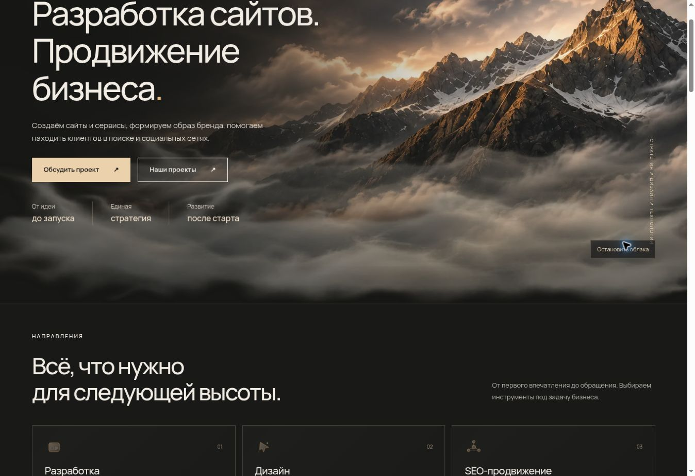

# Исправление движения облаков

Итоговая область изменений: только облака на существующей главной и управление их движением. Исходные горы, тексты, навигация и все остальные разделы сохранены. Рамки, линии, схемы и новые горные пейзажи из предыдущего предложения убраны.

Два прозрачных слоя движутся над неподвижной исходной фотографией. Кнопка паузы сохраняет положение, включение продолжает движение. При системной настройке уменьшения движения анимация по умолчанию выключена, но посетитель может явно её включить. Фоновая вкладка приостанавливает движение; ручная пауза при возврате сохраняется.

Проверено: check, 13 тестов, Worker и статическая сборки. В браузере подтверждены изменение transform при движении, неизменное положение на паузе и возобновление после нажатия. Мобильные размеры 320, 375 и 768 px проверены ранее с теми же слоями облаков и не менялись в финальной версии. Публикации нет, ожидается согласование.

