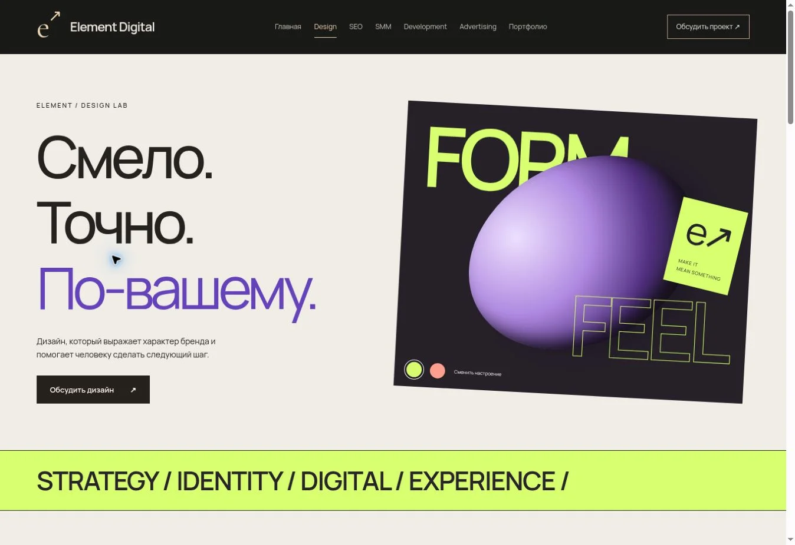
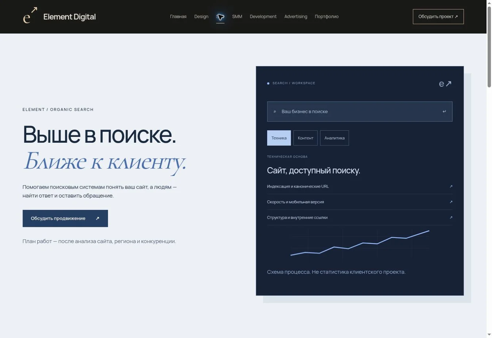

# Аудит и результат

Исходная точка: `e33f4227fd6565dc13f8aab4b1ff1b44841806c1`, ветка `main`. Редизайн выполняется в `feat/premium-multipage`.

## Аудит

Одна HTML-страница, Node.js-сборка без зависимостей, отдельные public-ресурсы, серверный обработчик Telegram. Услуги и проекты из конфигурации отрисовывались JavaScript. Навигация была якорной, sitemap отсутствовал, canonical указывал на прежний домен. Вариант GitHub Pages уже существовал, но нуждался в отдельном HTTPS backend для формы.

## Изменения

12 HTML-страниц с отдельными URL и общими компонентами. Приоритетные главная, Design и SEO имеют самостоятельные визуальные решения. Остальные направления также содержат законченные тексты, состав работ и общую форму. Сохранены исходные материалы и исторические исходники. Существующие три проекта получили интерактивные демострации без реальных платежей и заявлений о клиентских результатах.

Подготовка формы работает на статическом хостинге. Серверная доставка сохранена и дополнена явным CORS для отдельного frontend, проверкой согласия и поддержкой базового пути. Добавлены уникальные метаданные, canonical, JSON-LD, sitemap, noindex демо, аналитика после согласия и проверочный CI без публикации.

## Проверка

- Синтаксис JavaScript и обе сборки.
- Автоматические тесты серверной валидации, лимитов, Origin/CORS, ошибок доставки и отсутствия ложного успеха.
- Проверка каждой страницы: один H1, уникальный title, canonical, отсутствие шаблонных токенов, существование локальных файлов и якорей.
- Серверные GET/HEAD, редирект на trailing slash, 404, безопасность формы, заголовки.
- В браузере: главная, Design, SEO; смена палитры и вкладок.
- Форма: при отключённой доставке показан текст сообщения и ручной переход в Telegram. Внешнее сообщение не отправлялось.
- Демо: фильтр ваз, добавление в корзину и сумма, демонстрация оформления; создание/поиск/смена статуса задачи; выбор домика и проверка дат.
- Мобильная компоновка главной, Design, SEO, SMM, Development, Advertising и Portfolio: ширина 375 px, отсутствие горизонтального переполнения, работа меню.

## Перед выпуском

Публикация, слияние в main, реальная доставка сообщений, production-аналитика, физические мобильные устройства и production Lighthouse в эту проверку не входят. Необходимы согласование вида/текстов, подтверждение контакта, данные оператора для окончательных условий обработки и, если нужна автоматическая доставка, настройка backend с контрольной заявкой. Существующий сайт не заменён.

## Изображения для согласования

### Главная

### Design

### SEO

