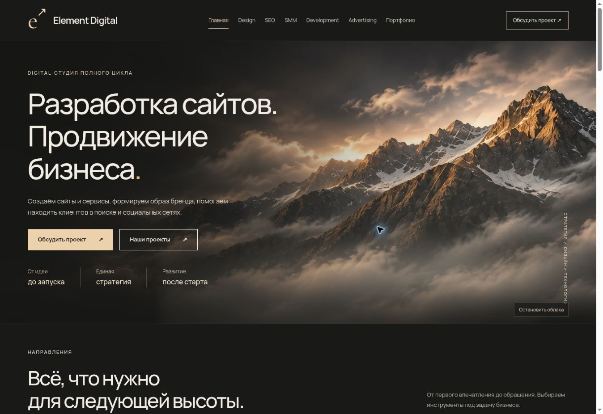
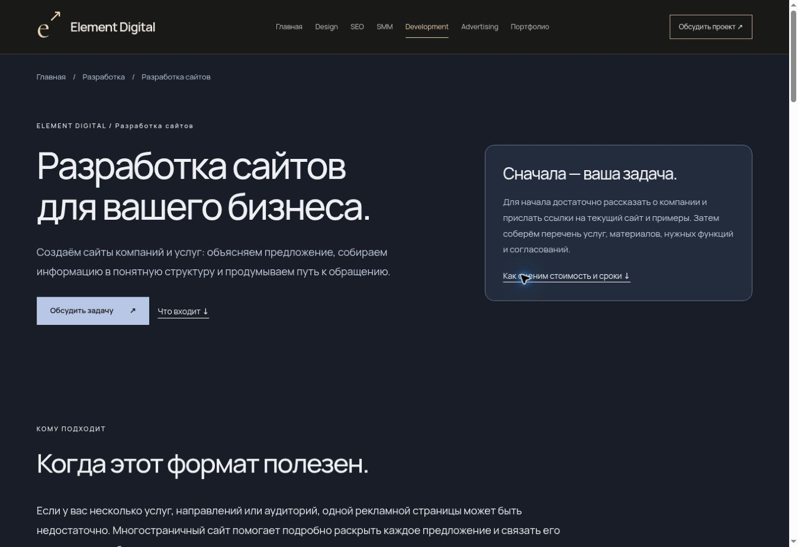
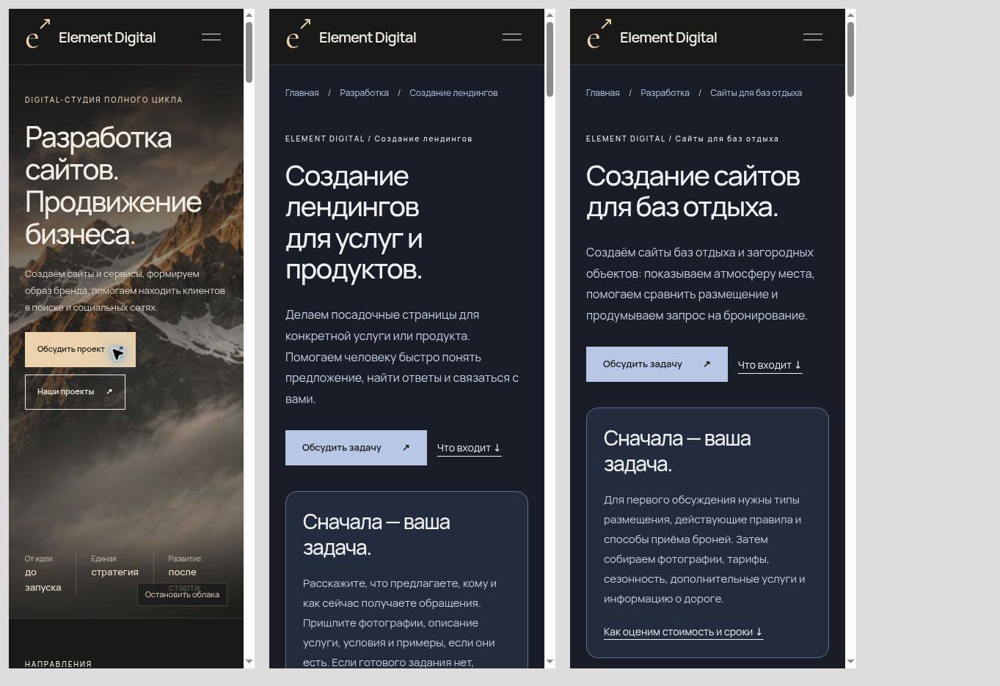

# Усиление содержания и структуры Element Digital

Ветка: `feat/seo-service-structure`. Изменения подготовлены к согласованию; действующий сайт не заменён.

## Изменения

- Главная сразу объясняет предложение: «Разработка сайтов. Продвижение бизнеса». Сохранены горы, облака, фирменный знак и существующие разделы.
- Добавлены самостоятельные страницы `/development/websites/`, `/development/landing-pages/` и `/development/recreation/`. У каждой своя задача, состав работ, результат, условия оценки бюджета и сроков, материалы для старта и вопросы с ответами.
- Главная и Development ссылаются на новые страницы обычными HTML-ссылками. Между страницами есть ссылки на близкие услуги, Design, SEO и демонстрации.
- Для новых страниц добавлены уникальные title, description, canonical, хлебные крошки и BreadcrumbList. Sitemap автоматически включает 11 индексируемых страниц. Всего в сборке 15 страниц; демонстрации и политика исключены из sitemap.
- На SEO, SMM, Advertising и Development раскрыты условия оценки, согласования и поддержки. Страница студии объясняет организацию работы, передачу результата и границы демонстраций.
- Добавлены события начала заполнения формы и перехода в Telegram. Существующие события подготовки и успешной отправки сохранены. События не содержат контакты или тексты обращений и работают только при подключённой аналитике и согласии.
- Сохранены Leonardo, дизайн-концепции и интерактивные демонстрации. Никакие вымышленные отзывы, клиентские достижения или числовые цены не добавлены.

## Проверка

- `npm run check`, `npm test`: все 11 тестов пройдены.
- Обе сборки: Worker и GitHub Pages, по 15 страниц.
- Проверены уникальные метаданные, один H1, canonical, локальные файлы, ссылки и якоря всех страниц, sitemap, robots, редиректы, 404, HEAD, защита обработчика заявок.
- В браузере проверены главная и новые посадочные, переход из главной, активная навигация, FAQ и кнопки обращения.
- На ширине 320 px главная, на 375 px лендинг и сайт базы отдыха не имеют горизонтальной прокрутки. Исправлен перенос длинного слова в существующем заголовке портфолио на мобильной главной.
- Проверен запасной сценарий формы: при недоступной прямой доставке явно показано, что сообщение нужно отправить самостоятельно. Внешнее сообщение при проверке не отправлялось.

## Что требует данных владельца

- Прямая доставка на GitHub Pages требует внешнего HTTPS-обработчика. Секреты Telegram на клиенте не размещаются. Без обработчика статическая форма только подготавливает сообщение.
- Для фактического подключения Метрики нужен идентификатор счётчика. События подготовлены, но работающий счётчик этим изменением не заявляется.
- Индексацию и выбранные Google canonical нужно проверить в Search Console после согласованной публикации. Данных Search Console в этой работе нет.
- Реальные цены, ответственный за проект, рабочая почта и город требуют подтверждения владельца. Они не выдуманы.
- Реальные клиентские проекты можно добавить после получения материалов и разрешения; демонстрации обозначены честно.

Основа: [Руководство Google по поисковой оптимизации](https://developers.google.com/search/docs/fundamentals/seo-starter-guide?hl=ru). Выполнение рекомендаций не гарантирует позиции.

## Внешний вид

